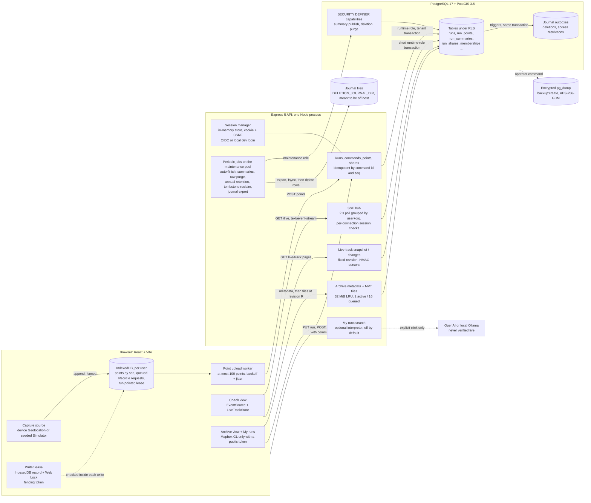

# Running Tracker: interview package

What this is: notes to speak from in a technical interview about this project, with links to the code and the
evidence. Everything here is a learning project verified on one Windows workstation. There are no production users,
no production incidents, no cloud account and no deployment; where this document says "measured", it names the
workload, the machine and what the number does and does not include.

Contents: [pitch](#the-pitch-6090-seconds) · [architecture](#architecture) ·
[delivery semantics](#delivery-semantics-in-one-paragraph) · stories
[A](#a-offline-buffering-retries-and-idempotent-persistence) [B](#b-one-writer-tab-and-fencing)
[C](#c-postgresql-rls-database-roles-and-transaction-scoped-tenant-context)
[D](#d-sse-permission-revalidation-and-revocation)
[E](#e-revision-bound-summaries-tracks-and-archive-tiles)
[F](#f-backup-restore-and-reapplying-deletions-and-access-restrictions) ·
[follow-up questions](#likely-follow-up-questions) · [scaling](#scaling-what-i-would-change-and-when) ·
[live demo](#live-demo) · [what is not established](#what-is-not-established)

## The pitch (60–90 seconds)

> Running Tracker is a project I built end to end to practise the hard parts of a small real-time system. A runner
> records a run in the browser, a coach they explicitly share it with watches it live, and finished runs go into a
> searchable archive drawn as vector tiles. It's React and an Express 5 API on PostgreSQL with PostGIS.
>
> The interesting part is what happens when things go wrong. Every GPS point is written to IndexedDB before it is
> uploaded, so a run survives going offline or a reload. Uploads are retried, so the server can see a batch twice;
> it stores each point by its sequence number and treats an exact repeat as a no-op, so the data ends up stored once.
> Only one tab may record, and a stale tab is shut out by a fencing token. Tenant isolation and sharing are enforced
> by PostgreSQL row-level security under a non-owner role, not by `WHERE` clauses I might forget. The coach's live
> stream rechecks the session, the membership and the share every two-second poll, so a revoked coach loses the run
> within about one poll. Summaries, live tracks and archive tiles are all bound to a revision, so stale work is
> rejected instead of published. And there's an encrypted backup with a restore drill that reapplies deletions and
> revoked access after a restore.
>
> It's verified on one machine: unit, PostgreSQL integration and browser suites, plus load measurements, which found
> one real bottleneck, in the RLS policies, which I fixed. What it doesn't have yet is real phone GPS validation, a
> real identity provider or any production traffic.

About 230 words, roughly 90 seconds. To get to 60 seconds, drop the backup sentence and the last paragraph's first
sentence.

## Architecture

What is where:

- Locally, Vite proxies `/api` to the API ([vite config](../apps/web/vite.config.ts)). The production profile puts
  nginx in front for TLS, HTTP/2 and an SSE location with buffering off
  ([ADR-0026](adr/0026-http2-reverse-proxy-sse-profile.md), [ADR-0043](adr/0043-single-host-deployment-profile.md)).
  The demo does not use nginx.
- The composition root is [main.ts](../apps/api/src/main.ts) (pools, session manager, SSE hub, periodic jobs) and
  [app.ts](../apps/api/src/app.ts) (routes). The maintenance jobs run inside the API process, on a separate pool and
  database role.
- Three roles: `running_tracker_owner` owns the objects and runs migrations; `running_tracker_runtime` is the API
  login; `running_tracker_maintenance` can only execute named functions. All three are `NOSUPERUSER NOBYPASSRLS`
  ([bootstrap-database.mjs](../scripts/bootstrap-database.mjs), [ADR-0003](adr/0003-p02a-database-boundary.md)).
- Three read endpoints named in the SDD (`/runs/{runId}/track`, `/archive/runs`, `/live/nearby`) were never built,
  and the OpenAPI document flags them `x-implemented: false`.

## Delivery semantics in one paragraph

Say this before any of the stories, because every one of them depends on it. **The network gives at-least-once
delivery at best**: the browser retries a batch until it gets an answer that accounts for every point, so the server
can receive the same batch several times, for example when the commit succeeded but the response was lost. **The
persistence is idempotent**: a point is keyed by `(org_id, run_id, seq)`, an exact repeat is acknowledged as a
duplicate without a write, and the same `seq` with a different payload is refused with `409 POINT_CONFLICT`.
Lifecycle commands work the same way with a client-chosen command id. The outcome is that each point is *stored*
once. That is not exactly-once delivery, and nothing here claims it: delivery can repeat, and points that never
leave the browser (cleared site data, a lost device) are simply lost. The E2E tests named "delivered exactly once"
assert that each sequence number exists once on the server after retries, which is this property.

## Six stories

Each one has the same five parts: what fails, what the code does, what it costs, the evidence and the limits.

### A. Offline buffering, retries and idempotent persistence

**Failure scenario.** The runner goes through a tunnel. The phone is offline for a minute, the tab may be reloaded,
and when the network comes back the first upload commits on the server but the response is lost. A naive client
either drops the points it could not send or sends them again and creates duplicates.

**Implementation.**
- Capture writes each point to IndexedDB first, in a transaction that also allocates a positive bigint `seq`
  ([runner-storage.ts](../apps/web/src/runner-storage.ts), [ADR-0008](adr/0008-indexeddb-runner-buffer.md)).
- [point-upload-worker.ts](../apps/web/src/point-upload-worker.ts) reads at most 100 points in `seq` order and
  deletes exactly those sequence numbers, and only after the answer satisfies `insertedCount + duplicateCount =
  batch size`. Network errors and 408/425/429/5xx keep the batch and retry with capped exponential backoff and full
  jitter (1 s base, 30 s cap), honouring `Retry-After`. Other 4xx answers stop that run's worker and keep its points
  for the person to export or discard ([ADR-0009](adr/0009-point-upload-worker.md),
  [ADR-0048](adr/0048-runner-review-recovery.md)).
- [run-service.ts `ingestRunPoints`](../apps/api/src/runs/run-service.ts) locks the run row, compares every repeated
  `seq` with its canonical stored payload, inserts only new points set-wise, and bumps `data_revision` once per batch
  that added anything. An exact retry returns 200 with `duplicateCount` and no revision change.
- Lifecycle commands (`pause`, `resume`, `finish`) carry a `commandId` and an `expectedControlRevision`. The server
  stores the canonical payload and the response in `run_commands` and replays the stored response for a repeat
  (`applyRunCommand`, same file). The browser keeps the exact request in IndexedDB until the confirmed run snapshot is
  stored, so "Retry same request" after a reload sends the same identity.
- A run is created with `PUT` and a client-generated id, so creation is idempotent too. A deleted id answers
  `410 RUN_DELETED` for one year (tombstone, [ADR-0036](adr/0036-tombstone-lifetime-and-late-retry-contract.md)).

**Trade-off.** Correctness lives on the server, so the client can be simple and retry blindly. The costs are a
canonicalisation step (millisecond time, `-0`, bigint as decimal string) so that "the same point" has one meaning,
a read of existing rows before each insert, and a run-row lock that serializes batches of one run. A retry window is
finite: new points to a finished run are accepted for 24 hours, tombstones protect ids for a year, and there is no
permanent used-id registry.

**Evidence.**
- [point-ingestion.integration.test.ts](../apps/api/test/point-ingestion.integration.test.ts) drops the response
  after a real `COMMIT` (a test-only hook, [fault-injection.ts](../apps/api/src/testing/fault-injection.ts), refused
  outside `APP_ENV=test`), sees `ECONNRESET`, checks the rows in SQL, retries and gets duplicates only.
- [reload-offline.spec.ts](../tests/e2e/reload-offline.spec.ts): reload mid-run, offline buffering and a failing
  upload, each ending with every `seq` stored once. These run in Chromium and in the Firefox core gate (recorded
  2026-10-22, [progress.md](progress.md)).
- Load scenario P11.3 sends exact and overlapping retries of 100-point batches
  ([p11-5-measurements-after.md](reports/p11-5-measurements-after.md): `retry-exact` and `retry-overlap` rows, no
  unexpected responses).
- Demo rehearsal on 2026-10-24 (below): offline for 8.6 s with 5 points pending; they were acknowledged 0.1–0.2 s
  after reconnecting, as one batch and one revision (`rev 9` → `rev 10`, 7 → 12 points on the coach's side).

**Limits.** The buffer is one browser's storage: clearing site data or losing the device loses unsent points.
Background capture on a phone was never tested: capture is foreground only and runs on the Simulator or desktop
Geolocation. The offline tests use Playwright's network emulation, not a real radio.

### B. One writer tab and fencing

**Failure scenario.** The runner has the app open in two tabs, or a tab freezes in the background, the user reloads,
and the old tab wakes up later. Two writers would allocate the same `seq` values for different points, or the old
tab would send a stale lifecycle command or clear the run the new tab is recording.

**Implementation.**
- One lease record per user in IndexedDB holds an owner id, an expiry (15 s, renewed) and a `fencingToken`
  ([writer-lease.ts](../apps/web/src/writer-lease.ts), [ADR-0010](adr/0010-browser-writer-lease.md)).
- The token is a durable epoch: release marks the record released and never deletes it, so a token is never issued
  twice. Before that change a release followed by a new acquire reissued token 1, an ABA bug I reproduced and fixed
  ([ADR-0053](adr/0053-monotonic-writer-lease-fencing-epoch.md)).
- The check that matters is *inside* each durable write: appending a point, allocating a capture segment, queueing or
  acknowledging a lifecycle request, storing a server answer and clearing a finished run all re-read the lease in
  the same IndexedDB transaction and refuse on a mismatch ([ADR-0055](adr/0055-scoped-writer-fenced-run-authority.md),
  [ADR-0059](adr/0059-writer-fenced-lifecycle-requests.md), [ADR-0060](adr/0060-writer-fenced-finished-run-clear.md)).
- A reload does not wait 15 s for the lease to expire: every tab holds a Web Lock named after its owner id, and a
  claimant replaces a live lease only once that lock proves the holder is gone
  ([writer-presence.ts](../apps/web/src/writer-presence.ts), [ADR-0047](adr/0047-reload-writer-recovery-and-capture-source.md)).

**Trade-off.** It is a browser-local lock, so it costs no server round trip and works offline. The price is a
single scope: it fences tabs of one browser profile and nothing else. Across devices the server's guarantees take
over: one active run per user (a unique partial index), command revisions, and `POINT_CONFLICT` on a reused `seq`.
That conflict halts the upload visibly. It does not merge two devices' points.

**Evidence.** [writer-lease-epoch.spec.ts](../apps/web/src/writer-lease-epoch.spec.ts) (overlapping transactions on
fake-indexeddb: stale renew, release, append and discard are refused, and concurrent acquires produce one winner);
browser tests [second-tab.spec.ts](../tests/e2e/second-tab.spec.ts) (also in Firefox),
[lifecycle-takeover.spec.ts](../tests/e2e/lifecycle-takeover.spec.ts) and
[new-run-takeover.spec.ts](../tests/e2e/new-run-takeover.spec.ts) (Chromium only).

**Limits.** No server-side writer lease exists. Clearing site data resets the epoch along with everything it could
have protected. "Duplicate tab" in the tests is modelled by copying sessionStorage.

### C. PostgreSQL RLS, database roles and transaction-scoped tenant context

**Failure scenario.** One missing `AND org_id = $1` in one query, or a coach endpoint that forgets to check the share,
and a person reads another organization's run. Separately, a pooled connection that keeps the previous request's
user id would make that request's identity leak into the next.

**Implementation.**
- [tenant-transaction.ts](../apps/api/src/database/tenant-transaction.ts) checks out one client, opens a
  transaction and sets `app.user_id` and `app.org_id` with `set_config(..., true)`, which is transaction-local, so
  the context dies with `COMMIT` or `ROLLBACK` and cannot leak through the pool. A commit transport error is reported
  as an unknown outcome and the connection is destroyed.
- [authenticated-tenant-transaction.ts](../apps/api/src/database/authenticated-tenant-transaction.ts) takes the user
  only from the verified server-side session and rechecks active membership inside the same transaction.
- Policies on every tenant table decide visibility: own runs, plus runs shared with `can_read_live` or
  `can_read_history`. History (raw points, summaries) needs the history grant, live state the live grant
  ([0002](../db/migrations/0002_runs_shares_rls.sql), [0003](../db/migrations/0003_run_points_summaries_rls.sql),
  [ADR-0004](adr/0004-runs-shares-acl-fragment.md), [ADR-0005](adr/0005-points-summaries-acl-fragment.md)).
- The API role owns no table, has no `BYPASSRLS` and no DDL. The maintenance role has no table DML at all and works
  only through `SECURITY DEFINER` functions with `search_path = pg_catalog`.
- Every runtime connection has PostgreSQL-enforced `statement_timeout` (5 s) and `lock_timeout` (2 s), mapped to a
  retryable 503 ([ADR-0050](adr/0050-runtime-sql-budgets.md)).

**Trade-off and the measured cost.** The load measurement found that RLS was nearly all the database time of the
hot reads: the first policies called a definer function per row, about 45–50 µs and 8 buffer hits each. I replaced
it with set-returning functions that compute the readable `(org_id, run_id)` pairs once per statement and are hashed
([0019](../db/migrations/0019_set_based_run_visibility.sql), [ADR-0042](adr/0042-set-based-run-visibility.md)). The
same EXPLAIN catalogue (seeded SDD-sized organization: 10 members, 3,650 runs; stress: 3 million raw points; one
workstation, database execution time only) went from 360 to 56 ms for a z11 archive tile and from 2,058 to 39 ms for
the first live-track page of a 42,857-point run. That made the cheap live poll slower (2 → 24 ms), so the live hub
declares a narrowing `visibilityScope: 'live'`, which can only remove rows.

**Evidence.** [rls-set-policies.integration.test.ts](../apps/api/test/rls-set-policies.integration.test.ts) compares
the set functions with the per-row specification for every fixture identity. The integration suite runs its security
assertions as the runtime role (463 tests in 45 files, recorded 2026-10-22 in [progress.md](progress.md)). The
before and after reports are [p11-measurements.md](reports/p11-measurements.md) and
[p11-5-measurements-after.md](reports/p11-5-measurements-after.md).

**Limits.** The tables do not use `FORCE ROW LEVEL SECURITY`, so the owner role bypasses RLS. That is why the API
must never hold owner credentials, and the seeder and restore tools that do are separate commands. A GUC is not a
security boundary against someone who already has runtime credentials and can run arbitrary SQL (ADR-0003, decision
6). The equivalence of the set policies is proven for the fixture matrix, not for every possible state, and the
hashed set does not spill, so a much larger organization would need another shape.

### D. SSE, permission revalidation and revocation

**Failure scenario.** A coach opens the live view and the stream stays open for hours. Meanwhile the session expires
or is signed out, the coach's membership is deactivated, or the runner revokes the share. If authorization were
checked only at connect time, the coach would keep receiving positions.

**Implementation** ([live-sse.ts](../apps/api/src/live/live-sse.ts), [live-state.ts](../apps/api/src/live/live-state.ts),
[ADR-0022](adr/0022-bounded-shared-sse-transport.md), [ADR-0023](adr/0023-live-stream-authorization-revalidation.md)).
- The initial state is read in a tenant transaction *before* the stream opens. The database client is released
  before the response stays open, so an open stream holds no connection.
- One scheduler polls every 2 s and groups subscriptions by user and organization, so tabs of one identity share one
  short read. Each poll checks membership and reads the RLS-filtered live state in one runtime-role transaction.
- Session validity is per connection. The hub keeps a digest of the session, not the cookie, and rechecks the store
  before the poll, publish, drain and heartbeat. A timer closes the stream exactly at session expiry.
- Membership loss closes the user's streams for that organization. Grant loss produces a complete state without the
  run, which replaces any older pending state.
- Backpressure: only the newest unsent state is kept, and a writer blocked for 10 s is closed. Connections (64) and
  poll concurrency (2) are bounded.
- The client ([coach-live-client.ts](../apps/web/src/coach-live-client.ts),
  [selected-track-sync.ts](../apps/web/src/selected-track-sync.ts)) reconnects after 1, 2 and 4 s, rechecks the
  session first, and keeps nothing visible until a new full state authorizes it again.

**Trade-off.** Revocation is eventual and bounded: about one poll interval plus one short transaction. The server
cannot recall bytes already in the transport buffer or on the screen, and the design says so instead of promising
it. SSE fits because observation is one-way and recording is already plain HTTP (SDD §3). Polling the database was
chosen over commit notifications for simplicity at the SDD's 10 users, and it puts a floor of about 2 s under live
latency.

**Evidence.** Unit tests in [live-sse.spec.ts](../apps/api/src/live/live-sse.spec.ts) cover revocation of one of two
sessions, revocation during the initial read, exact expiry and blocked-state replacement.
[live-state.integration.test.ts](../apps/api/test/live-state.integration.test.ts) changes grants and membership
against real PostgreSQL. Browser: [run-sharing.spec.ts](../tests/e2e/run-sharing.spec.ts) (Chromium and Firefox).
Load (P11.5, one workstation, 10 SSE observers): fresh point to observer stream p95 1,993 ms ordinary and 2,009 ms
stress, measured to the SSE event and not to the rendered screen. Rehearsal 2026-10-24: the coach's card appeared
1.9 s after the share and disappeared 1.9–2.1 s after the revoke.

**Limits.** All of this lives in one process, with an in-memory session store, so an API restart ends every stream
and every session. The real HTTP/2 path was verified against the local nginx profile only (`transport:verify`).
No SSE pending-buffer size is exported, so "stable buffer" is not confirmed by measurement.

### E. Revision-bound summaries, tracks and archive tiles

**Failure scenario.** The summary worker computes a run's distance while a late batch is still arriving, then
publishes a stale summary. A coach pages through a live track while new points are inserted and gets a page made of
two different versions. A cached archive tile still shows a run after it was deleted or its share was revoked.

**Implementation.**
- Every change that matters bumps a counter in the same transaction: `runs.data_revision` for points and lifecycle,
  `organizations.archive_revision` for anything that changes what the archive shows (summary published or deleted,
  history grant, membership) ([0013](../db/migrations/0013_archive_cache_invalidation.sql),
  [ADR-0030](adr/0030-atomic-archive-cache-invalidation.md)).
- **Summaries** are calculated for a fixed `source_revision` in one statement snapshot without a run lock, then
  published under organization and run locks only if the run still has exactly that revision, is finished and has no
  tombstone. Workers deduplicate with transaction-scoped advisory claims, and the row lock is the correctness fence
  ([run-summary-publication.ts](../apps/api/src/maintenance/run-summary-publication.ts),
  [ADR-0013](adr/0013-revision-bound-summary-calculation.md), [ADR-0015](adr/0015-revision-checked-summary-publication.md),
  [ADR-0016](adr/0016-bounded-distributed-summary-workers.md)).
- **Live tracks**: the first page fixes revision R in the same statement, continuations stay at R, and a changes
  request returns points ingested in `(A, T]` plus each changed point's successor, so a late lower `seq` repairs both
  of its edges. Cursors are HMAC-signed and bound to user, organization, run, operation and revisions. The browser
  applies a snapshot only after its last page succeeds
  ([live-track-cursor.ts](../apps/api/src/runs/live-track-cursor.ts), [live-track-sync.ts](../apps/web/src/live-track-sync.ts),
  ADRs [0017](adr/0017-revision-fixed-live-track-snapshot.md)–[0021](adr/0021-atomic-browser-live-track-application.md)).
- **Archive tiles**: the metadata answer contains a tile URL template with the archive revision in it. Each tile
  request rechecks membership and the current revision in a runtime-role transaction and answers
  `409 ARCHIVE_REVISION_CHANGED` for a stale URL. The process cache key includes the revision and the user, so an old
  entry can never be served for a new revision ([archive-service.ts](../apps/api/src/archive/archive-service.ts),
  [archive-tile-cache.ts](../apps/api/src/archive/archive-tile-cache.ts),
  ADRs [0027](adr/0027-archive-http-authorization-boundary.md)–[0032](adr/0032-bounded-archive-tile-generation.md)).
- One versioned SQL edge evaluator (`evaluate_track_edge`: sequence, segment, accuracy, time and speed rules) is used
  by summaries, live tracks and the live position, so "is this edge real" has one definition
  ([ADR-0012](adr/0012-versioned-track-edge-evaluation.md)).

**Trade-off.** Invalidation never needs a purge step and cannot race, because a new revision is a new key. But it is
coarse: any archive-visible change in an organization invalidates every tile of that organization. Summary latency is
set by the worker cadence (60 s), not by the finish.

**Evidence.** [run-summary-publication.integration.test.ts](../apps/api/test/run-summary-publication.integration.test.ts)
(a blocked-ingestion race, deletion, duplicate concurrent publishers);
[live-track-snapshot](../apps/api/test/live-track-snapshot.integration.test.ts) and
[live-track-changes](../apps/api/test/live-track-changes.integration.test.ts) integration tests;
[archive-tile.integration.test.ts](../apps/api/test/archive-tile.integration.test.ts) and
[archive-http.integration.test.ts](../apps/api/test/archive-http.integration.test.ts). In the load runs, 15 of 17,630
tile requests (ordinary, with tile bursts) got `revision-changed`, which is the mechanism doing its job while a
summary was published. Finish to summary visible was 60.4–61.0 s in all runs, so the SDD's 60 s goal stays "not
confirmed" ([p11-5-measurements-after.md](reports/p11-5-measurements-after.md)). In the rehearsal the summary was
listed 26 s and 42 s after Finish, which depends on where the worker was in its minute.

**Limits.** The tile cache is per process (32 MiB, five-minute TTL), and eviction under pressure was never exercised:
the peak was 10.7 MiB. The real Mapbox basemap was never rendered in any test; the Coach map runs on a fake runtime
plus one WebGL smoke against a local empty style.

### F. Backup, restore, and reapplying deletions and access restrictions

**Failure scenario.** The database is lost and restored from last night's backup. That backup still contains runs
that their owners deleted this morning, and shares and memberships that were revoked this morning. A plain restore
would bring back deleted personal data and give revoked people their access back.

**Implementation.**
- `backup:create` encrypts a `pg_dump` custom archive with AES-256-GCM (key from a file, never stored with the
  backup) and reads it back to authenticate it ([backup-create.ts](../apps/api/src/backup/backup-create.ts),
  [ADR-0044](adr/0044-backup-restore-drill.md)).
- Every deletion (by the owner or by annual retention) writes an identifier-only row to `run_deletion_journal` in the
  same transaction as the tombstone and the cascade ([0018](../db/migrations/0018_deletion_journal.sql),
  [ADR-0037](adr/0037-durable-deletion-journal.md)). Triggers on `memberships` and `run_shares` write
  `access_restriction_journal` rows for exactly three kinds of change: membership deactivated, share revoked, share
  narrowed. A grant is never journaled ([0020](../db/migrations/0020_access_restriction_journal.sql),
  [ADR-0045](adr/0045-access-restriction-journal.md)).
- A job exports pending rows as NDJSON to `DELETION_JOURNAL_DIR`, and deletes them from the database only after the
  file is fsynced and renamed, so a crash re-exports a batch and duplicates are harmless
  ([journal-export.ts](../apps/api/src/maintenance/journal-export.ts)).
- Recovery order: restore, migrate, `restore:reapply-deletions`, `restore:reapply-access`, then an explicit
  `GRANT CONNECT` by the operator. Until that grant the application cannot reach the database
  ([runbook](runbooks/backup-and-restore.md), [reapply-deletions.ts](../apps/api/src/restore/reapply-deletions.ts),
  [reapply-access.ts](../apps/api/src/restore/reapply-access.ts)).
- Both replays are idempotent and validate every file first. The access replay can only deactivate, delete or
  narrow, and its file format cannot express a grant, so a forged or stale file can at worst remove access.

**Trade-off.** It fails closed. Access granted after the backup is not reconstructed and has to be granted again, and
a share revoked and then granted again before the loss is removed again. The recovery point for deletions and
restrictions is the export interval (30 s by default) plus the off-host copy, not zero.

**Evidence.** The restore drill (`npm run restore:drill`) runs the whole order against real PostgreSQL/PostGIS in
throwaway databases, with each replay done twice. [p12-4-restore-drill.md](reports/p12-4-restore-drill.md) (2026-10-01)
records 30 passing checks, including "recovered permissions equal the lost source's", checked as the runtime role
under RLS, and "recovery added no access". Its measured RTO, 3.4 s from loss to verified on a 15.9 MiB database, says
nothing about a production RTO.

**Limits.** The code cannot verify that the journal directory is really off-host; that and backup scheduling, off-host
copies, key custody and the backup-age alert belong to the operator ([deployment.md](runbooks/deployment.md)). Sessions
do not survive a restore: they live in process memory, so everyone signs in again. No production RPO or RTO exists.

## Likely follow-up questions

**"So is it exactly-once?"** No. Delivery is at least once, and the server makes repeats harmless by key. If the
browser loses its storage before an upload, those points are gone; nothing on the server can know about them.

**"What if the commit succeeds and the response is lost?"** The client keeps the batch and retries the same points.
The server finds every `seq` already stored with the same payload and answers 200 with `duplicateCount`, without a
new revision. There is an integration test that drops the response after a real `COMMIT`.

**"What if the retry has the same `seq` but different coordinates?"** `409 POINT_CONFLICT` for the whole batch, and
nothing is written. The worker stops for that run and keeps the points, because silently overwriting history is
worse than a visible stop.

**"Two phones recording for the same user?"** The tab lease does not help across devices. The server allows one
active run per user, so the second start fails. If both somehow wrote to one run, reused `seq` values would conflict
and halt the upload. Merging two devices is not designed.

**"Why RLS instead of checks in the service layer?"** One definition of who can read what, enforced even for a query
I write later and get wrong. The cost was real and measured, and the set-based policy removed most of it.
Integration tests run as the runtime role, so they test the policy and not a superuser's view.

**"Why SSE and not WebSockets?"** The coach only receives. SSE is plain HTTP with cookie authentication, the browser
reconnects natively, and it worked through nginx over HTTP/2 with buffering disabled. WebSockets would not remove
the need to recover from the database after a disconnect (SDD §14).

**"Why poll every 2 s instead of LISTEN/NOTIFY?"** It is simple and self-healing, and it is enough for 10 people
(SDD §3). It also sets the latency floor: the measured fresh-point p95 of about 2 s is the poll interval. Commit
notifications plus a periodic reconciliation are the documented next step once a poll cycle gets close to 2 s.

**"A revoked coach already has the data on screen. Is that a leak?"** It is the documented limit: what was
delivered before the revocation cannot be recalled. The next complete state omits the run, the client removes its
current and last-known data, and blocked pending states are replaced, not flushed.

**"How do you stop a slow summary worker from publishing old numbers?"** Publication re-reads the run under a lock
and requires the exact source revision. A point committed during the calculation changed `data_revision`, so the
old result is discarded without a write.

**"Why put the revision in the tile URL instead of using a cache TTL?"** A TTL lets a revoked share stay visible until
it expires. A revision makes an old URL fail with 409, and the client fetches the new metadata. The TTL only bounds
memory.

**"What did load testing actually find?"** One bottleneck, the per-row RLS predicate, with before and after numbers
from the same commands. The other candidates (page-limited track reads, a GiST-friendly tile query, a large revision
index) were measured and deliberately not changed. Ingestion p95 was about 95–105 ms against a 500 ms goal, on one
machine running the runner, the API and PostgreSQL together.

**"How is it tested?"** Unit tests per workspace (`npm run verify`: 2,384 tests on 2026-10-28 at base `d088ba5`;
2,321 earlier at commit `eff3a71`); PostgreSQL/PostGIS integration as the real roles (463, restore drill included);
Playwright against the real API and database (115 tests in Chromium plus OIDC, 10.1 min on 2026-10-28; 109 in about
12.3 min in the earlier supplied report); an 18-test Firefox core gate (two clean runs on 2026-10-22, a third on
2026-10-28) and a 24-test pre-demo smoke in Chromium and Firefox (both passed once on 2026-10-28; see
`docs/reports/pause-verification.md`); Docker verifiers for the production profile, the TLS/HTTP/2 transport and the
restore drill. One GitHub-hosted CI run passed, on 2026-10-14 for commit `83f804f`, with 87 browser tests then; later commits
have workstation runs only.

**"Is the sign-in real?"** The production path is OpenID Connect with PKCE, state and nonce, invite-only. It was
tested only against an in-process test provider and a real `oidc-provider` process in Chromium. The demo uses a
development login that the API refuses in production and that production builds of the web app do not contain.

**"Where is the AI?"** An optional box turns a sentence into a proposal for the search filters; the person still
presses Apply. It is off by default. The OpenAI path has never been called with a real key. A local Ollama run
(`qwen3:8b`, CPU only, 2026-10-14) missed the 10 s deadline for every search case and answered two other cases with
one wrong outcome. So: no accuracy claim, and the deterministic search is the product.

**"What would you do next?"** Real-device GPS traces (the tooling exists, but no recording has been analysed yet:
D10), a real identity provider, a shared session store if there is ever a second API instance, and a hosted CI run
of the current commit.

## Scaling: what I would change, and when

**Implemented now.** One API process on one host, with PostgreSQL on the same host in the production profile. Inside
that process: the session store and OIDC login store (memory, bounded by `SESSION_STORE_MAX_ENTRIES`), the SSE hub
(64 connections), the tile cache and its admission (32 MiB, 2 active and 16 queued generations) and the maintenance
jobs. Maintenance work already claims rows with advisory locks or `SKIP LOCKED`, and duplicate concurrent summary
publishers are tested, but a deployment with several API instances was never run.

**Measured** (P11.5, [p11-5-measurements-after.md](reports/p11-5-measurements-after.md)): one Ryzen AI 7 350
workstation (16 logical CPUs, 15 GiB RAM) running the load runner, the API and PostgreSQL 17.5; the SDD dataset (10
members, 3,650 finished runs; stress 3 million raw points); 10 SSE observers, 10 concurrent 100-point batches per
round, two overlapping tile streams; 3 runs per group, client-measured over loopback.

| What | Result | Boundary |
|---|---|---|
| Ingestion request p95 | 95 ms ordinary, 105 ms stress (goal ≤ 500 ms) | socket hand-off to last body byte, tile bursts running |
| Fresh point → observer p95 | 1,993 / 2,009 ms (goal ≤ 5 s) | to the SSE event; no browser render |
| Archive tile p95 | 131–195 ms by zoom | under closed-loop bursts |
| Finish → summary visible | 60.4–61.0 s | includes the 60 s worker cadence; goal not confirmed |
| Peak resident memory | 217 MiB with tiles, 89 MiB without | one API process |

**Proposed, not implemented.** Each item is conditional on a signal that has not been observed yet.

- *If a second API instance is needed* (availability or CPU): the in-memory session store is the first blocker, since
  every restart already signs everyone out. Move sessions to PostgreSQL or Redis, or accept sticky routing as a stopgap.
  SSE needs no shared state because each instance polls the database, but database poll load grows with instances ×
  (user, organization) groups. The revision-keyed tile cache stays correct per process and only its hit rate drops;
  a shared cache is the SDD's suggestion (§14).
- *If the live poll cycle approaches 2 s* (a metric already exported) or the latency floor matters: commit
  notifications to wake the poll, keeping the periodic full read for recovery. SSE → WebSocket would not change this.
- *If summary latency matters*: shorten `RUN_SUMMARY_INTERVAL_MS` or wake the worker on finish. The workers are
  already safe to run concurrently.
- *If organizations grow far past 3,650 readable runs per member*: the hashed visibility set does not spill (ADR-0042),
  so bound it or change its shape, and measure first.
- *If one organization's archive changes often*: invalidation is per organization, so a busy organization keeps
  missing the cache. Per-user or per-dataset revisions are the SDD's next step.
- *If raw points outgrow the seven-day purge*: partitioning has to keep `(org_id, run_id, seq)` unique, which
  PostgreSQL makes awkward, so it means redesigning deduplication rather than adding partitions (SDD §14).

## Live demo

Follow the rehearsal in [runbooks/demo.md](runbooks/demo.md#rehearsal-the-whole-story-in-57-minutes): `npm run
demo:up`, two browser profiles, **Demo runner** and **Demo coach**, no typing and no token. On 2026-10-24 it was
driven twice in two isolated headless Chromium contexts against a real `demo:up`. All eleven steps passed in 70 s
and 85 s of automated time, most of it the 10 s simulator capture and the wait for the summary worker. Plan 5–7
minutes with talking.

Without a Mapbox token, show the coach's card and the "N points · rev R" track count changing, and the runner's
**My runs** card. Do not promise that the coach sees a shared *finished* route: the Coach tab lists live runs only,
and **My runs** lists only the signed-in person's own runs.

Where each story shows up: A in the offline step, B by opening a second tab of the runner's profile (it stays
read-only), C and D in Share and Revoke, E in the revision numbers on the coach's side and the summary wait, F not at
all (point to the drill report instead).

## What is not established

- Real GPS on a phone, permission prompts, background capture: never tested. Capture used the Simulator or desktop
  Geolocation, and the D10 real-device pilot is waiting for physical recordings
  ([real-device-pilot.md](reports/real-device-pilot.md)).
- A real identity provider and provider-side logout: never tested.
- Browsers: the full suite runs in Chromium. Firefox, on Windows, runs the 18-test core gate and the 24-test pre-demo
  smoke, not the rest of the suite. Nothing was run in Safari or a mobile browser, OIDC sign-in in Firefox was not
  tested, the real map runtime ran only in Chromium (against a local empty style), and the real Mapbox basemap was
  not rendered anywhere.
- CI: one GitHub-hosted run passed, for `83f804f` on 2026-10-14; later commits, including the pause verification of
  2026-10-28 ([pause-verification.md](reports/pause-verification.md)), have workstation runs only.
- AI search quality: no OpenAI call has ever been made, and local Ollama missed the deadline on this CPU.
- Production: no host, no users, no traffic model, no RPO or RTO. Everything measured ran on one workstation.
